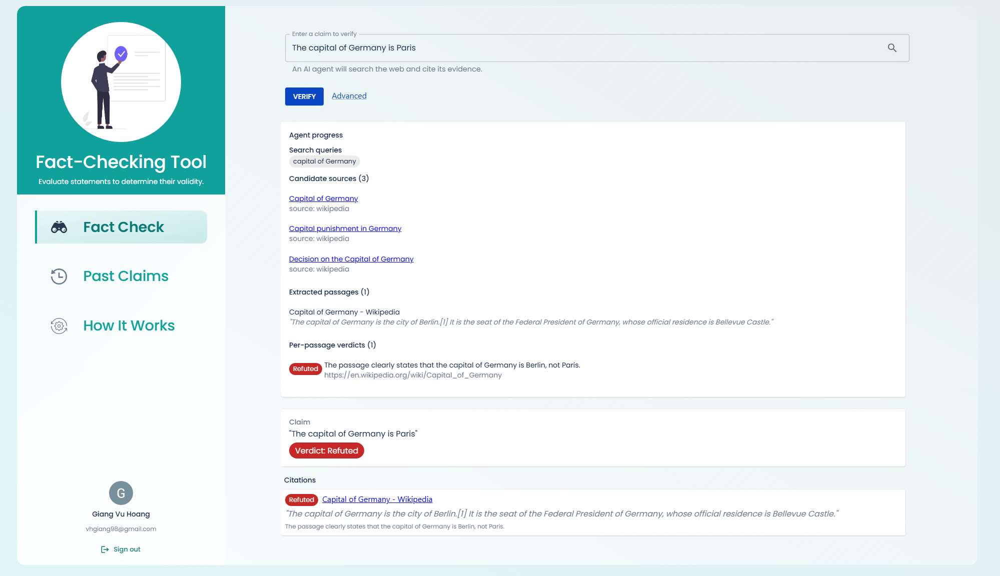

# Fact-Checking

An agent-driven fact-checking web app. You submit a natural-language claim and three LLM agents search the web, gather evidence, and return a verdict (`SUPPORTED` / `REFUTED` / `NOT_ENOUGH_INFO`) backed by citations. You watch the agents work in real time: every query, source, and judgement streams to the browser as it happens.

Live at **https://factchecking.dpdns.org** (when the demo cluster is running).



## How it works

A claim flows through a LangGraph pipeline of three agents, each powered by an LLM — hosted via [OpenRouter](https://openrouter.ai) (default) or local via Ollama:

```
 claim ───▶ Orchestrator ── write_todos ──▶ sub-claims (1 for a simple claim)
                │ delegate, in parallel
                ▼
        Researcher subagents ── search · fetch_page · extract_passage
                │ passages (raw pages stay in per-run files)
                ▼
        Claim Verification, per sub-claim ──▶ verdict + citations
```

1. **Plan** — the orchestrator splits the claim into atomic sub-claims ("A and B" becomes two) and keeps a todo list.
2. **Research** — one subagent per sub-claim searches Wikipedia / DuckDuckGo / Brave, fetches pages, and extracts the relevant sentences. Each runs in its own context, so page text never reaches the orchestrator; it only sees a short summary. It writes the search queries and, when evidence is thin or one-sided, retries a sub-claim with new queries or with a new focus that re-reads the pages already saved (no new search or fetch).
3. **Verification** — the LLM judges entailment per passage; a majority vote gives each sub-claim's verdict, and the overall verdict is REFUTED if any part is refuted, SUPPORTED only if every part is.

Research is bounded (sub-claims, retries, turns, tool calls, wall-clock; see the `AGENT_*` settings). When a bound trips, the run verifies what it has, so the worst case is `NOT_ENOUGH_INFO`, not an error.

The pipeline streams named Server-Sent Events as it runs; the React client renders an agent timeline that fills in live, so you see *why* the verdict is what it is, not just the answer.

## Design highlights

- **Spec-first contract** — the whole API, including every SSE payload, is defined once in `api/openapi.yaml`; Pydantic models and TypeScript types are both generated from it, so the two ends cannot drift. → [`api/`](api/README.md)
- **Typed SSE on both ends** — a backend registry pins each event name to its payload model, mirrored by a frontend type map with a compile-time exhaustiveness guard; adding an event without a payload breaks the build. → [`server/`](server/README.md), [`web-client/`](web-client/README.md)
- **Agentic retry** — the LangGraph state machine loops back to search with fresh queries when retrieval comes up empty, instead of failing on the first miss. → [`server/`](server/README.md)
- **Full IaC deployment** — Terraform-provisioned AKS behind the Kubernetes Gateway API with automatic Let's Encrypt TLS, budget alerts, and stop/start scripts. → [`infra/`](infra/README.md)

## Tech stack

| Layer | Technology |
|---|---|
| LLM runtime | OpenRouter (default, e.g. `anthropic/claude-haiku-4.5`) or Ollama (`qwen2.5:7b-instruct`), selected by `LLM_PROVIDER` |
| Agents | LangGraph + LangChain |
| Backend | FastAPI · Pydantic v2 · SQLite · sse-starlette |
| Frontend | React 18 · Redux Toolkit · MUI v5 · Vite · TypeScript (strict) |
| Auth | Google OAuth 2.0 + JWT cookies |
| Contract | OpenAPI 3.1 → `datamodel-codegen` (Python) + `openapi-typescript` (TS) |
| Infra | Docker Compose (local) · Terraform + AKS + Gateway API (cloud) |

## Run it locally

Requires Docker with Compose v2, **Google OAuth credentials** (the app has a login screen — create an OAuth client in [Google Cloud Console](https://console.cloud.google.com) and put the ID/secret in `server/.env`; details in [`server/README.md`](server/README.md)), and an LLM backend:

**OpenRouter (default)** — set `LLM_PROVIDER=openrouter`, `OPENROUTER_API_KEY` ([get one](https://openrouter.ai/keys); paid models need credits) and `OPENROUTER_MODEL` in `server/.env`, then:

```bash
docker compose up -d --build
```

**Ollama (local)** — set `LLM_PROVIDER=ollama` and `OLLAMA_MODEL`, then enable the `ollama` profile:

```bash
docker compose --profile ollama up -d --build
# First run downloads qwen2.5:7b-instruct (~4.7 GB). A GPU helps; CPU works but is slow.
```

Open **http://localhost**. The API is at `http://localhost:8000` (Swagger UI at `/docs`). Compose uses `http://localhost/api/v1/auth/google/callback` as the OAuth redirect URI, so register it in Google Cloud Console.

For native development with hot reload (server/client on the host), see [`server/README.md`](server/README.md) and [`web-client/README.md`](web-client/README.md).

## Repo layout

| Path | Purpose |
|---|---|
| [`api/`](api/README.md) | OpenAPI spec + codegen tooling. Single source of truth for the public contract. |
| [`server/`](server/README.md) | FastAPI + LangGraph backend (OpenRouter or Ollama) — agents, config, tests. |
| [`web-client/`](web-client/README.md) | React + Redux web client — streaming, type safety. |
| [`infra/`](infra/README.md) | Terraform (AKS cluster) + Kubernetes manifests + deployment. |
| `docker-compose.yaml` | Full-stack local run (server + web; Ollama via `--profile ollama`). |
